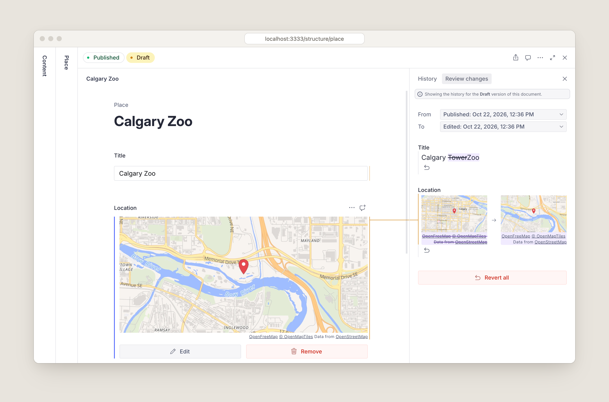
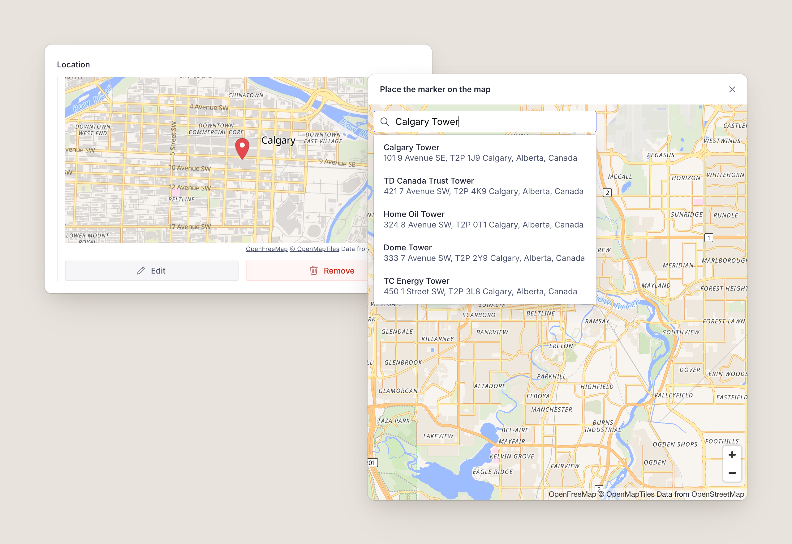
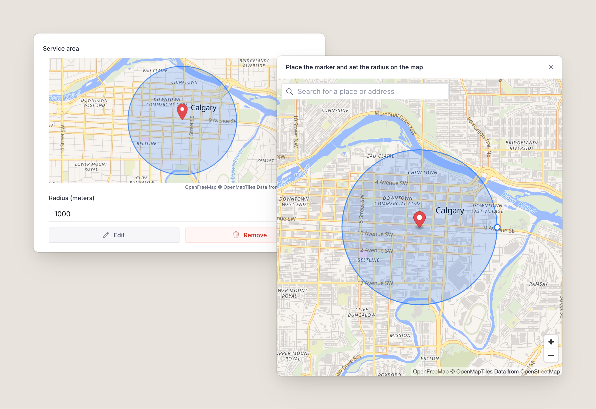
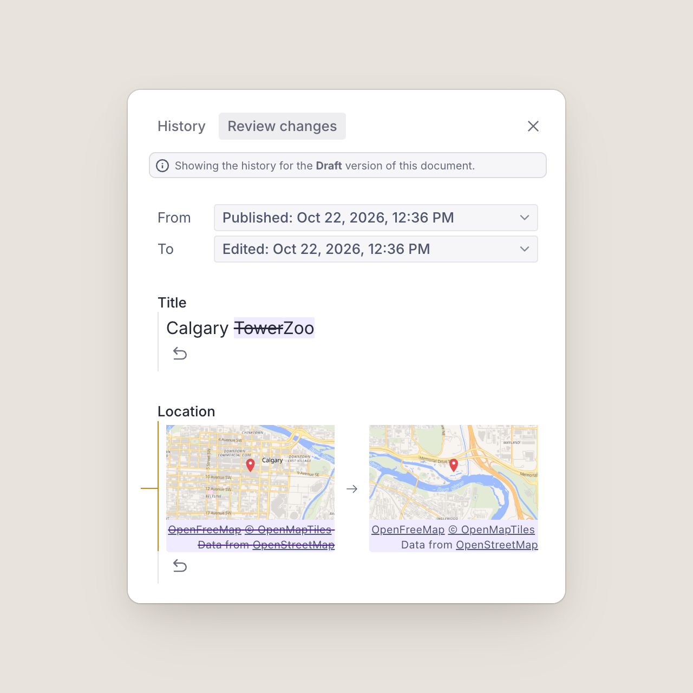

# sanity-plugin-maplibre

[](https://www.npmjs.com/package/sanity-plugin-maplibre) [](https://github.com/builtbyfield/sanity-plugin-maplibre/actions/workflows/ci.yml) [](https://codecov.io/gh/builtbyfield/sanity-plugin-maplibre) [](LICENSE)

Map inputs for [Sanity Studio](https://www.sanity.io) that need no API key. It's a drop-in replacement for [`@sanity/google-maps-input`](https://www.npmjs.com/package/@sanity/google-maps-input) built on open-source maps instead of Google:

- [MapLibre GL JS](https://maplibre.org) renders the map.
- [OpenFreeMap](https://openfreemap.org) serves the tiles, from [OpenStreetMap](https://www.openstreetmap.org) data.
- [Photon](https://photon.komoot.io) or [Nominatim](https://nominatim.org) handle address search, or plug in your own.

It replaces the `geopoint` input and adds a `geopointRadius` type. Existing content works as it is ([Migrating](#migrating-from-sanitygoogle-maps-input)).



## Contents

- [Install](#install) and [Usage](#usage)
- [Configuration](#configuration)
- [Map styles](#map-styles): [switching](#switching-styles), [per field](#per-field-styles), [PMTiles](#pmtiles-and-protomaps)
- [Geocoding](#geocoding): [Photon](#photon-default), [Nominatim](#nominatim), [your own](#your-own-geocoder)
- [Components](#components)
- [Migrating from `@sanity/google-maps-input`](#migrating-from-sanitygoogle-maps-input)
- [How previews work](#how-previews-work), [Network and CSP](#network-and-csp)
- [Troubleshooting](#troubleshooting) and [Limitations](#limitations)
- [Development](#development)

## Install

```sh
npm install sanity-plugin-maplibre
```

It needs Sanity Studio v5 or v6 (React 19.2).

## Usage

```ts
// sanity.config.ts
import { defineConfig } from "sanity"
import { maplibreInput } from "sanity-plugin-maplibre"

export default defineConfig({
  // ...
  plugins: [maplibreInput()],
})
```

Every `geopoint` field now uses the map input, including `geopoint` fields inside arrays and objects:

```ts
defineField({ name: "location", title: "Location", type: "geopoint" })
```

The field shows a map of the point, with **Edit** and **Remove**. **Edit** (or double-clicking the map) opens a larger map where editors click to place the point, drag the marker or search for an address. An empty field can also be set without a mouse: pan the map with the arrow keys, then choose **Place marker at map center**.



The plugin also registers `geopointRadius`, a point with a radius stored in meters. Editors drag the circle's edge on the map or type the number:

```ts
defineField({ name: "serviceArea", title: "Service area", type: "geopointRadius" })
```

```json
{ "_type": "geopointRadius", "lat": 51.0443, "lng": -114.0631, "radius": 1500 }
```



### In arrays

Items in an array of `geopoint` or `geopointRadius` show a small map of the point (and the circle, for a radius), with the coordinates as the title and the radius as the subtitle, in place of Sanity's plain `lat: …, lng: …` text. To choose their style, see [Per-field styles](#per-field-styles).

### Reviewing changes

`geopointRadius` fields show a before and after map in **Review changes** automatically. `geopoint` is a built-in Sanity type; add the diff to each field where you want it:

```ts
import { GeopointDiff } from "sanity-plugin-maplibre"

defineField({ name: "location", type: "geopoint", components: { diff: GeopointDiff } })
```



## Configuration

All options are optional.

```ts
maplibreInput({
  defaultLocation: { lat: 51.0447, lng: -114.0719 },
  defaultZoom: 11,
  saveZoom: true,
  radiusUnit: "mi",
  geocoder: "photon",
})
```

| Option              | Default                                    | Description                                                                                                 |
| ------------------- | ------------------------------------------ | ----------------------------------------------------------------------------------------------------------- |
| `defaultLocation`   | Oslo, `{lat: 59.91273, lng: 10.74609}`     | Where the map opens for an empty field.                                                                     |
| `defaultZoom`       | `8`                                        | Zoom the map opens at for `geopoint` fields.                                                                |
| `defaultRadiusZoom` | `12`                                       | Zoom the map opens at for `geopointRadius` fields.                                                          |
| `defaultRadius`     | `1000`                                     | Radius in meters for a new `geopointRadius` value. 1 to 50,000.                                             |
| `radiusUnit`        | `"m"`                                      | Unit the radius is shown and typed in: `"m"`, `"km"`, `"ft"` or `"mi"`. Always stored in meters.            |
| `saveZoom`          | `false`                                    | Save the editor's zoom on `geopoint` values as `zoom`; previews use it.                                     |
| `defaultLocale`     | none                                       | Language for search results, like `"en"` or `"de-CH"`.                                                      |
| `style`             | OpenFreeMap Liberty, and Dark in dark mode | A [MapLibre style](https://maplibre.org/maplibre-style-spec/) URL or object. See [Map styles](#map-styles). |
| `styles`            | none                                       | Styles editors can switch between. Use `style` or `styles`, not both.                                       |
| `defaultStyle`      | the first of `styles`                      | Name of the style maps and previews start with.                                                             |
| `setupMaplibre`     | none                                       | Runs once with the MapLibre module before any map is created. See [PMTiles](#pmtiles-and-protomaps).        |
| `geocoder`          | `"photon"`                                 | Address search: `"photon"`, `"nominatim"`, `false`, or an adapter. See [Geocoding](#geocoding).             |
| `workerUrl`         | jsDelivr                                   | Where MapLibre loads its web worker from. See [Network and CSP](#network-and-csp).                          |

An invalid option throws an error naming it as soon as the Studio loads.

## Map styles

Maps use [OpenFreeMap](https://openfreemap.org)'s Liberty style, and its Dark style while the Studio is dark. Any [MapLibre style](https://maplibre.org/maplibre-style-spec/) works instead: another OpenFreeMap style, your own, or a commercial provider's (with its key in the URL).

```ts
import { maplibreInput, openFreeMapStyle } from "sanity-plugin-maplibre"

maplibreInput({ style: openFreeMapStyle("positron") }) // "liberty", "bright", "positron", "dark" or "fiord"
maplibreInput({ style: "/static/brand-style.json" }) // a JSON file in your Studio's static/ folder
maplibreInput({ style: brandStyle }) // a style object, such as one built with @builtbyfield/maplibre-expr
```

Attribution always shows: on the map it can't collapse, and previews show it as a caption. Make sure your own styles' sources declare theirs.

### Switching styles

With `styles`, the map dialog gets a style menu, and each editor's choice is remembered. Previews and **Review changes** always use the default style.

```ts
maplibreInput({
  styles: [
    { name: "streets", title: "Streets", style: openFreeMapStyle("liberty"), dark: openFreeMapStyle("dark") },
    { name: "light", title: "Light", style: openFreeMapStyle("positron"), dark: openFreeMapStyle("dark") },
    { name: "brand", title: "Brand", style: "/static/brand-style.json" },
  ],
  defaultStyle: "streets",
})
```

| Style option |                                                                                        |
| ------------ | -------------------------------------------------------------------------------------- |
| `name`       | Stable id. The switcher remembers choices by name, and fields refer to styles by name. |
| `title`      | Shown in the menu. Defaults to `name`.                                                 |
| `style`      | A style URL or style object.                                                           |
| `dark`       | Used instead of `style` while the Studio is dark, in the dialog and previews.          |

### Per-field styles

A field can set its own styles with `options.maplibre`, which overrides the plugin's:

```ts
defineField({
  name: "trailhead",
  type: "geopoint",
  options: { maplibre: { style: openFreeMapStyle("bright") } },
})

defineField({
  name: "venue",
  type: "geopoint",
  // Names refer to the plugin's styles; objects add new ones.
  options: { maplibre: { styles: ["light", { name: "trails", style: trailsStyle }], defaultStyle: "trails" } },
})
```

`options.maplibre` takes `style`, `styles` and `defaultStyle`, which work like the plugin options. It's typed for `geopoint` and `geopointRadius` fields. Invalid field options show an error in place of the input.

For arrays, set them on the member type, not the array field:

```ts
defineField({
  name: "stops",
  type: "array",
  of: [{ type: "geopoint", options: { maplibre: { style: openFreeMapStyle("positron") } } }],
})
```

### PMTiles and Protomaps

[PMTiles](https://docs.protomaps.com/pmtiles/) is a single-file tile archive you can host on any static storage, with no tile server. MapLibre reads it through a protocol handler, which `setupMaplibre` registers before the first map loads:

```sh
npm install pmtiles @protomaps/basemaps
```

```ts
import type { StyleInput } from "sanity-plugin-maplibre"
import { layers, namedFlavor } from "@protomaps/basemaps"
import { Protocol } from "pmtiles"

function protomapsStyle(flavor: "light" | "dark"): StyleInput {
  return {
    version: 8,
    glyphs: "https://protomaps.github.io/basemaps-assets/fonts/{fontstack}/{range}.pbf",
    sprite: `https://protomaps.github.io/basemaps-assets/sprites/v4/${flavor}`,
    sources: {
      protomaps: {
        type: "vector",
        url: "pmtiles://https://maps.example.com/region.pmtiles",
        attribution: "<a href=\"https://protomaps.com\">Protomaps</a> © <a href=\"https://openstreetmap.org/copyright\">OpenStreetMap</a>",
      },
    },
    layers: layers("protomaps", namedFlavor(flavor), { lang: "en" }),
  }
}

maplibreInput({
  setupMaplibre: (maplibre) => {
    maplibre.addProtocol("pmtiles", new Protocol().tile)
  },
  styles: [{ name: "protomaps", title: "Protomaps", style: protomapsStyle("light"), dark: protomapsStyle("dark") }],
})
```

The host must support HTTP range requests and CORS; Cloudflare R2, S3 and most CDNs do. [Protomaps](https://docs.protomaps.com/basemaps/downloads) publishes builds of the whole planet and tools to cut out a region. `setupMaplibre` is also the place for other one-time setup, like `maplibre.setRTLTextPlugin()`.

## Geocoding

The search box sits in the corner of the map. Picking a result moves the point there and zooms the map to fit the place.

### Photon (default)

[Photon](https://github.com/komoot/photon) is an OpenStreetMap search engine built for search-as-you-type. The plugin waits 300 ms after the last keystroke, needs at least three characters, cancels requests the editor has typed past, caches results and ranks places near the map's center higher.

```ts
import { maplibreInput, photon } from "sanity-plugin-maplibre"

maplibreInput({
  geocoder: photon({
    lang: "de", // the public instance supports default, de, en and fr
    limit: 8,
    bbox: [5.9, 45.8, 10.5, 47.8], // only results in Switzerland
    layers: ["house", "street", "city"],
  }),
})
```

The public instance at photon.komoot.io is run by [komoot](https://www.komoot.com) for fair use, with no guarantees. If you have many editors or need an uptime promise, [run your own](https://github.com/komoot/photon#installation) and point `baseUrl` at it.

| `photon()` option              | Default                                                                | Notes                                                                  |
| ------------------------------ | ---------------------------------------------------------------------- | ---------------------------------------------------------------------- |
| `baseUrl`                      | `https://photon.komoot.io`                                             |                                                                        |
| `lang`                         | the plugin's `defaultLocale`                                           | Languages the server doesn't support are left out rather than failing. |
| `supportedLanguages`           | `default`, `de`, `en`, `fr` on the public instance; anything elsewhere |                                                                        |
| `limit`                        | `5`                                                                    |                                                                        |
| `bias`                         | `true`                                                                 | Rank results near the map center higher.                               |
| `bbox`                         | none                                                                   | `[west, south, east, north]` to restrict results to.                   |
| `layers`, `osmTags`            | none                                                                   | Photon's `layer` and `osm_tag` filters.                                |
| `debounceMs`, `minQueryLength` | `300`, `3`                                                             |                                                                        |

### Nominatim

[Nominatim](https://nominatim.org) is OpenStreetMap's own search. It searches when the editor presses Enter, because the public instance's [usage policy](https://operations.osmfoundation.org/policies/nominatim/) doesn't allow autocomplete.

```ts
import { maplibreInput, nominatim } from "sanity-plugin-maplibre"

maplibreInput({
  geocoder: nominatim({ email: "web@example.com", countryCodes: ["ca", "us"] }),
})
```

On the public instance the plugin follows the policy for you:

- **No autocomplete.** `autocomplete: true` throws unless `baseUrl` is your own server.
- **One request a second at most**, queued and shared by every field and workspace using that server.
- **Identification** by the browser's `Referer` header, plus `email` if you set it (browsers can't set a User-Agent). Setting `email` lets the OSM Foundation contact you before blocking you.

For heavy use, [run your own](https://nominatim.org/release-docs/latest/admin/Installation/):

```ts
nominatim({ baseUrl: "https://nominatim.example.com", autocomplete: true, minIntervalMs: 0 })
```

| `nominatim()` option | Default                               | Notes                                                                                     |
| -------------------- | ------------------------------------- | ----------------------------------------------------------------------------------------- |
| `baseUrl`            | `https://nominatim.openstreetmap.org` |                                                                                           |
| `email`              | none                                  | Sent as `email=` for identification.                                                      |
| `lang`               | the plugin's `defaultLocale`          | Sent as `accept-language`.                                                                |
| `limit`              | `5`                                   |                                                                                           |
| `countryCodes`       | none                                  | ISO 3166-1 alpha-2 codes.                                                                 |
| `viewbox`, `bounded` | none                                  | Prefer, or with `bounded: true` only return, results inside `[west, south, east, north]`. |
| `autocomplete`       | `false`                               | Self-hosted servers only.                                                                 |
| `minIntervalMs`      | `1000`                                | Can go lower for self-hosted servers only.                                                |

### Your own geocoder

Pass an object with `mode` and `search`, or just a search function, which is treated as autocomplete. `search` gets an `AbortSignal`; pass it to `fetch` so abandoned searches are cancelled.

```ts
import type { Geocoder } from "sanity-plugin-maplibre"

const myGeocoder: Geocoder = {
  name: "my-geocoder",
  mode: "autocomplete", // or "submit" to search on Enter
  debounceMs: 250,
  async search(query, { signal, lang, proximity }) {
    const response = await fetch(`https://geo.example.com/search?q=${encodeURIComponent(query)}`, { signal })
    const places = await response.json()
    return places.map(place => ({
      id: place.id,
      label: place.name,
      description: place.address, // optional second line
      location: { lat: place.lat, lng: place.lon },
      bbox: place.bbox, // optional [west, south, east, north]; the map fits it
    }))
  },
}

maplibreInput({ geocoder: myGeocoder })
```

To hide the search box, set `geocoder: false`.

## Components

The plugin already uses these; they're exported for your own inputs and previews.

### GeopointThumbnail

The array-item thumbnail as a component, for your own preview media, such as a document's location in lists and search:

```tsx
import { GeopointThumbnail } from "sanity-plugin-maplibre"

defineType({
  name: "place",
  type: "document",
  fields: [/* … */],
  preview: {
    select: { title: "title", location: "location" },
    prepare: ({ title, location }) => ({
      title,
      media: <GeopointThumbnail value={location} />,
    }),
  },
})
```

It fills its container, draws a dot on the point (and the circle for a `geopointRadius` value), follows the Studio's dark mode and shows the style's attribution as a tooltip. A schema file that uses it needs a `.tsx` extension.

| Prop        | Default                       |                                                                                                              |
| ----------- | ----------------------------- | ------------------------------------------------------------------------------------------------------------ |
| `value`     |                               | A `geopoint` or `geopointRadius` value, or anything with `lat` and `lng`. Renders an empty box without both. |
| `styleName` | the plugin's default style    | One of the plugin's style names.                                                                             |
| `style`     |                               | A style URL or object to use instead of the plugin's styles.                                                 |
| `zoom`      | the value's `zoom`, else `13` | Ignored for a radius, which is fitted to the image.                                                          |
| `size`      | `80`                          | Rendered size in CSS pixels, drawn at 2x.                                                                    |

### GeopointInput and GeopointRadiusInput

To use one on a single field without the plugin, pass options as `geoConfig`, defined once outside the component:

```tsx
import { GeopointInput } from "sanity-plugin-maplibre"

const mapOptions = { defaultLocation: { lat: 51.0447, lng: -114.0719 } }

defineField({
  name: "location",
  type: "geopoint",
  components: { input: props => <GeopointInput {...props} geoConfig={mapOptions} /> },
})
```

`GeopointRadiusInput` works the same way, but the `geopointRadius` type itself comes from the plugin.

### GeopointDiff

The before and after maps for **Review changes**. See [Reviewing changes](#reviewing-changes).

## Migrating from `@sanity/google-maps-input`

1. Swap the package:

   ```sh
   npm uninstall @sanity/google-maps-input
   npm install sanity-plugin-maplibre
   ```

2. Rename the plugin and remove the API key:

   ```diff
   - import {googleMapsInput} from '@sanity/google-maps-input'
   + import {maplibreInput} from 'sanity-plugin-maplibre'

     plugins: [
   -   googleMapsInput({apiKey: 'my-api-key', defaultZoom: 8, saveZoom: true}),
   +   maplibreInput({defaultZoom: 8, saveZoom: true}),
     ]
   ```

3. Update the `GeopointDiff` import, if you use it:

   ```diff
   - import {GeopointDiff} from '@sanity/google-maps-input'
   + import {GeopointDiff} from 'sanity-plugin-maplibre'
   ```

Your content doesn't change: `geopoint` and `geopointRadius` values keep the same shape, including `zoom` (with `saveZoom`) and `radius` in meters.

| `@sanity/google-maps-input`                                                        | `sanity-plugin-maplibre`                                                                  |
| ---------------------------------------------------------------------------------- | ----------------------------------------------------------------------------------------- |
| `googleMapsInput()`                                                                | `maplibreInput()`                                                                         |
| `apiKey`                                                                           | Not needed. If you leave it in, it's ignored with a console warning.                      |
| `defaultLocation`, `defaultZoom`, `defaultRadiusZoom`, `defaultRadius`, `saveZoom` | Same names.                                                                               |
| `defaultLocale`                                                                    | Same; used for search results.                                                            |
| `GeopointDiff`, `GeopointInput`, `GeopointRadiusInput`                             | Same names. `geoConfig` is optional; without it the inputs use the plugin's options.      |
| `geopointRadius` type                                                              | Same fields and validation (radius 1 to 50,000 m).                                        |
| Google Places search                                                               | Photon by default, with results from OpenStreetMap.                                       |
| Static Maps previews                                                               | Rendered in the browser with your map style. See [How previews work](#how-previews-work). |

The new options are `style`, `styles`, `defaultStyle`, `setupMaplibre`, `geocoder`, `radiusUnit` and `workerUrl`, plus per-field `options.maplibre`. Maps also follow the Studio's dark mode.

## How previews work

There's no keyless static map API; previews are rendered in the browser. Hidden MapLibre maps, one per style and at most three, draw each view and save it as an image. Images are cached, render when they scroll into view, and are skipped if no longer needed. However many previews a page has, it uses at most three WebGL contexts, of which browsers allow only a few. The hidden maps shut down after 30 seconds idle.

MapLibre loads the first time a map or preview appears and isn't part of the Studio's initial bundle. Importing the plugin in Node, for example in a CLI script or a test, never loads it.

## Network and CSP

With the defaults, editors' browsers request:

| Host                                  | For                               |
| ------------------------------------- | --------------------------------- |
| `tiles.openfreemap.org`               | Map style, tiles, fonts and icons |
| `photon.komoot.io` (or your geocoder) | Search                            |
| `cdn.jsdelivr.net`                    | MapLibre's web worker             |

Other styles, PMTiles archives and geocoders add their own hosts.

MapLibre 6 can't find its worker inside a bundled app like the Studio. By default the plugin loads the worker from jsDelivr, pinned to the exact MapLibre version it ships with. To self-host it instead, copy `node_modules/maplibre-gl/dist/maplibre-gl-worker.mjs` to your Studio's `static/` folder and set:

```ts
maplibreInput({ workerUrl: "/static/maplibre-gl-worker.mjs" })
```

The worker URL is set once per page: with several workspaces, the first map's `workerUrl` is used.

If your Studio sets a Content Security Policy, allow those hosts in `connect-src`, plus `blob:` in `worker-src` (only needed for a cross-origin worker) and in `img-src` (for the previews).

## Troubleshooting

**The map stays grey, or the console mentions MapLibre's worker.** The worker didn't load. Check that `cdn.jsdelivr.net` is reachable and allowed by your CSP (`worker-src blob:`), or [self-host the worker](#network-and-csp).

**"The map couldn't load" in the dialog.** The style failed to load: check its URL, or that a JSON file in `static/` is valid style JSON. With several styles, editors can switch to another from the menu. Missing tiles alone don't cause this.

**"Map preview unavailable".** A preview couldn't render; the console says why. Usually the style failed to load or the browser has WebGL turned off.

**"This field's map options are invalid".** The field's `options.maplibre` is wrong, for example a style name the plugin doesn't define. The message says what to fix.

**A PMTiles map is blank.** Check that `setupMaplibre` registers the protocol, and that the host answers range requests with CORS headers.

**Search ignores the language.** The public Photon instance only supports `default`, `de`, `en` and `fr`; other languages are left out of the request.

## Limitations

- Coordinates can't be typed in. Points are placed on the map, by search, or at the map's center.
- Map thumbnails replace `geopoint` previews in arrays. Elsewhere, such as in Portable Text, Sanity shows its built-in text preview.
- No satellite imagery by default; there's no free source. Use a style that has it.
- The public Photon and Nominatim instances are for fair use. For many editors, run your own.

## Development

```sh
pnpm install
pnpm dev        # the test Studio in dev/, against the source in src/
pnpm test       # unit tests, watch mode
pnpm e2e        # browser tests against the harness page
pnpm check      # lint, typecheck, unit tests, build, smoke test
```

`pnpm dev` opens a Studio with three workspaces: a style switcher with Photon, Nominatim with `saveZoom` and miles, and PMTiles. It uses Built by Field's dev project; to point it at your own, copy `dev/.env.example` to `dev/.env` and set your project ID and dataset. For quick checks without logging in, `pnpm --filter sanity-plugin-maplibre-dev harness` serves the map components on their own at http://localhost:3334.

See [CONTRIBUTING.md](CONTRIBUTING.md) for the code layout, the tests and how releases work.

## Credits

Map data © [OpenStreetMap contributors](https://www.openstreetmap.org/copyright), tiles by [OpenFreeMap](https://openfreemap.org) and [OpenMapTiles](https://openmaptiles.org), search by [Photon](https://github.com/komoot/photon) (komoot) and [Nominatim](https://nominatim.org), rendering by [MapLibre](https://maplibre.org). If the plugin is useful to you, consider supporting [OpenFreeMap](https://openfreemap.org) and the [OpenStreetMap Foundation](https://supporting.openstreetmap.org).

## About

[Built by Field](https://www.builtbyfield.com) is a design and technology studio in Calgary. We build interactive maps on vector tiles and MapLibre, and we maintain this plugin and [`@builtbyfield/maplibre-expr`](https://github.com/builtbyfield/maplibre-expr). If you're working on a Sanity or MapLibre project and want help, [get in touch](https://www.builtbyfield.com/contact).

## License

MIT
